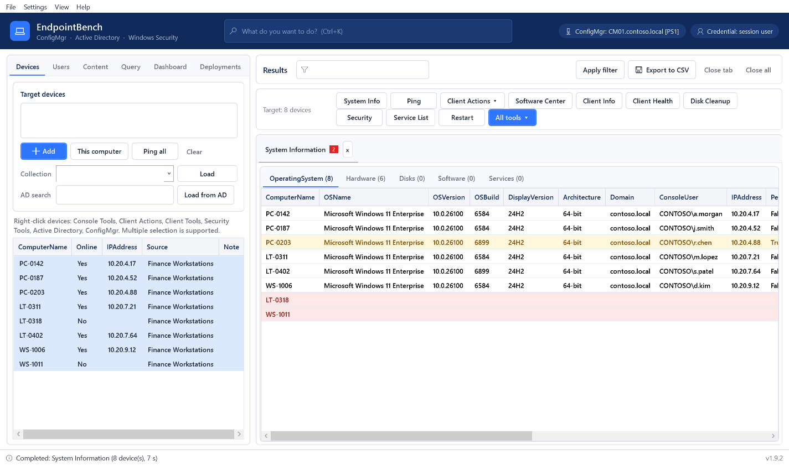

<p align="center">
  
</p>

<h1 align="center">EndpointBench</h1>

<p align="center">
  Device, user and deployment management for Microsoft Configuration Manager and Active Directory<br>
  <a href="https://endpointbench.com">endpointbench.com</a> ·
  <a href="../../releases/latest">Download</a> ·
  <a href="#türkçe">Türkçe</a>
</p>

---

EndpointBench brings the everyday tools of endpoint administration into one window: device and user troubleshooting, Configuration Manager client actions, client health repair, content and deployment analysis, security status and Active Directory tasks. It integrates into the right-click menus of the ConfigMgr console and is free to use.

## Features

| Area | What you get |
|---|---|
| **Device tools** | System information, processes, services, restart and shutdown, Wake on LAN, remote registry, event viewer, remote desktop |
| **ConfigMgr client** | All client action cycles, Remote Software Center, client information, cache management, repair and uninstall |
| **Client Health** | 14 diagnostic checks, a health score per device, targeted repairs with automatic re-diagnosis |
| **Deployments** | Deployment status, error analysis grouped by the actual error code, guided retry, live status from the device, ConfigMgr client notification fallback |
| **Content distribution** | Content status per distribution point, validation, redistribution of failed transfers |
| **Disk Cleanup** | Measures and cleans update leftovers, temporary files and the ConfigMgr cache |
| **Security** | BitLocker, TPM, Secure Boot, Microsoft Defender, Windows Firewall, LAPS |
| **Active Directory** | Computer and user accounts, group membership, password and account state |
| **Dashboards** | BitLocker, LAPS, hardware and firmware, AD cleanup, software update compliance |
| **Console integration** | Right-click menus for devices, users, collections and deployments in the ConfigMgr console |

EndpointBench is agentless: it uses WMI/CIM, PowerShell remoting, the ConfigMgr SMS Provider and LDAP with your own permissions. It has no telemetry and does not send data to its authors.

## Requirements

- 64-bit Windows 10, Windows 11 or Windows Server 2016 or later
- Windows PowerShell 5.1 and .NET Framework 4.7.2 or later (included in supported Windows versions)
- Microsoft Configuration Manager console installed on the same computer

See the user guide for network ports and permissions.

## Download and installation

Download the package in your language from the [latest release](../../releases/latest):

| File | Description |
|---|---|
| `EndpointBench-<version>-en-US.msi` | Installer, English |
| `EndpointBench-<version>-tr-TR.msi` | Installer, Turkish |
| `EndpointBench-UserGuide-<version>-en-US.pdf` | User guide, English |
| `EndpointBench-UserGuide-<version>-tr-TR.pdf` | User guide, Turkish |
| `SHA256SUMS.txt` | Checksums of the files above |

Run the MSI and follow the setup, or install silently:

```
msiexec /i EndpointBench-<version>-en-US.msi /qn /l*v "%TEMP%\EndpointBench-install.log"
```

Restart the ConfigMgr console after installation to see the **EndpointBench** right-click menu. Installing a newer package upgrades the existing installation and keeps user settings.

### Verifying the download

```powershell
Get-FileHash .\EndpointBench-<version>-en-US.msi -Algorithm SHA256
```

Compare the result with `SHA256SUMS.txt` in the release.

> **Note:** The packages are not code-signed yet. Windows SmartScreen and User Account Control may show the publisher as unknown. Verify the checksum before installing.

## Documentation

The user guide is installed with the product (**Help ▸ User guide**) and is attached to every release as PDF in English and Turkish.

## License

EndpointBench is free software provided under the [EndpointBench End User License Agreement](LICENSE.txt). It is not open source: the source code is not published, and redistribution of modified copies is not permitted.

Microsoft, Windows, Active Directory, BitLocker and Microsoft Configuration Manager are trademarks of the Microsoft group of companies. EndpointBench is not affiliated with or endorsed by Microsoft.

---

## Türkçe

EndpointBench, Microsoft Configuration Manager ve Active Directory yöneticileri için cihaz, kullanıcı ve dağıtım yönetimini tek pencerede toplar: cihaz ve kullanıcı sorun giderme, ConfigMgr istemci eylemleri, istemci sağlığı onarımı (Client Health), içerik ve dağıtım hata analizi, güvenlik durumu ve Active Directory işlemleri. ConfigMgr konsolunun sağ tık menülerine eklenir ve ücretsizdir.

**Gereksinimler:** 64 bit Windows 10/11 veya Windows Server 2016 ve üzeri, Windows PowerShell 5.1, aynı bilgisayarda kurulu Configuration Manager konsolu.

**İndirme ve kurulum:** [Son sürüm](../../releases/latest) sayfasından Türkçe paketi (`EndpointBench-<sürüm>-tr-TR.msi`) indirip çalıştırın. Sessiz kurulum için:

```
msiexec /i EndpointBench-<sürüm>-tr-TR.msi /qn /l*v "%TEMP%\EndpointBench-install.log"
```

Kurulumdan sonra ConfigMgr konsolunu yeniden açın; sağ tık menüsünde **EndpointBench** grubu görünür. Yeni sürüm paketi mevcut kurulumu yükseltir, kullanıcı ayarları korunur.

**Doğrulama:** İndirdiğiniz dosyanın SHA256 değerini `Get-FileHash` ile hesaplayıp sürümdeki `SHA256SUMS.txt` ile karşılaştırın. Paketler henüz kod imzalı değildir; Windows yayımcıyı "bilinmiyor" olarak gösterebilir.

**Belgeler:** Kullanım kılavuzu ürünle birlikte kurulur (**Yardım ▸ Kullanım kılavuzu**) ve her sürüme Türkçe ve İngilizce PDF olarak eklenir.

**Lisans:** EndpointBench, [EndpointBench Son Kullanıcı Lisans Sözleşmesi](LICENSE.txt) kapsamında ücretsiz sunulur. Açık kaynak değildir; kaynak kodu yayımlanmaz ve değiştirilmiş kopyalar dağıtılamaz.
